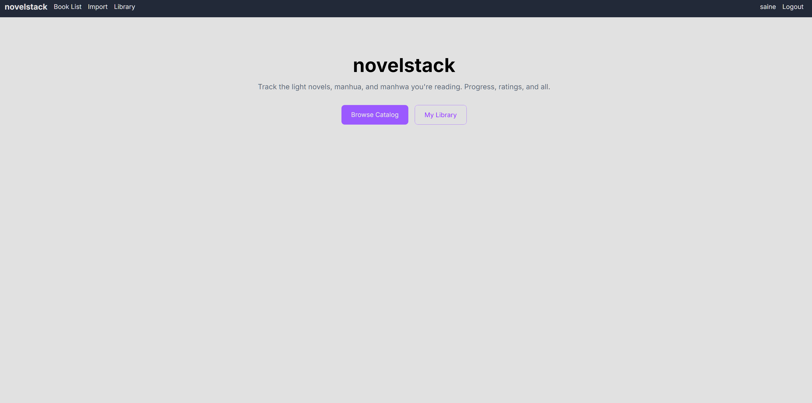
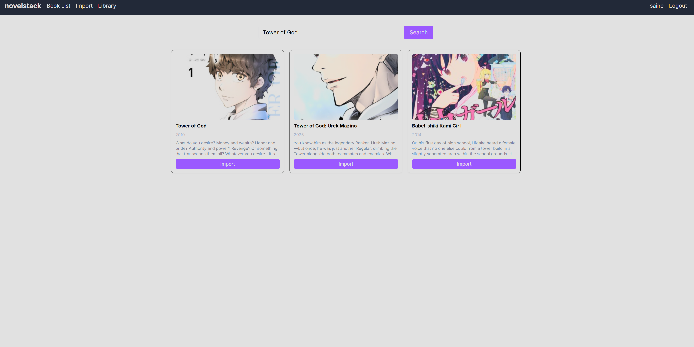
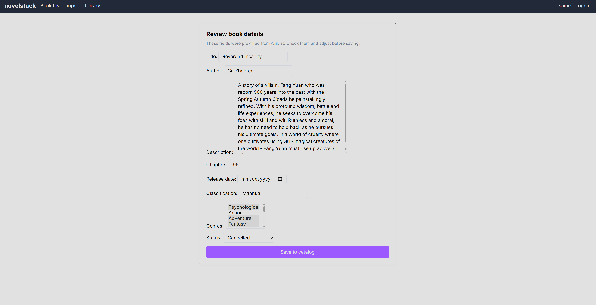
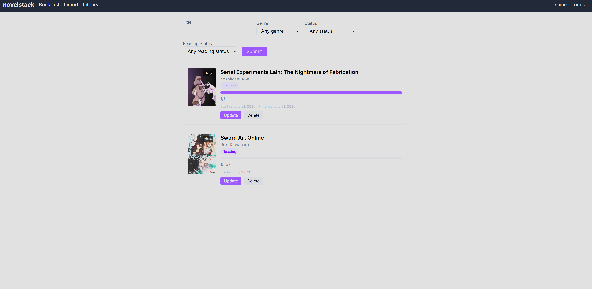

# novelstack

A library and reading tracker for Asian novels. Anyone can browse the catalog, and
signed-in users can keep a personal library to track what they're reading.

## Why I built it

I've been reading novels for years, and I use AniList as my main tracker. I wanted to
build one of my own to see what actually goes into making something like it, even if
it's only a small fraction of what AniList does.

## Live demo

[novelstack](http://35.170.80.39:8000/)

The app runs as a single Fargate task with a public IP and no load balancer, so the
address can change if the container restarts. If the link is dead, the
[screenshots](#screenshots) below show the same thing.

## Features

- A public catalog anyone can browse, search, and filter by title, genre, and status
- A personal library where you can track each book's reading status, progress,
  rating, and dates
- A profile page with your reading stats
- A staff-only import form that pulls books from the AniList API, with a review step
  before anything is saved
- User accounts with registration, login, and password reset

## Tech stack

| Area           | What I used                                    |
|----------------|------------------------------------------------|
| Web app        | Django 6.0, Gunicorn, WhiteNoise, Tailwind CSS |
| Data           | PostgreSQL, psycopg2, Pydantic                 |
| External API   | AniList GraphQL API, called with `requests`    |
| Testing        | pytest                                         |
| Infrastructure | Docker, AWS (ECR, ECS Fargate, RDS)            |
| CI/CD          | GitHub Actions with OIDC                       |

A few of these choices are worth explaining:

- **Django** comes with an ORM, authentication, forms, and an admin panel, which
  covered most of what this project needed out of the box.
- **Gunicorn** runs the app in production, since Django's built-in server isn't meant
  for that.
- **WhiteNoise** serves the CSS and images straight from the app, so I don't need a
  separate server or bucket for static files.
- **Pydantic** validates the raw AniList responses before they reach the code that
  maps them to my models.

## Data model

Genres are stored in their own table instead of as text on each book, and genre
filtering only returns books that match the selected genres exactly. The database
also enforces data integrity on its own: unique constraints prevent duplicate
entries, and a check constraint keeps reading progress from going past a book's total
chapter count.

## Data source

Book data comes from the AniList GraphQL API. I originally planned to use WLN Updates
for cover art, but its API had been returning errors for over a year, so I switched
to AniList, since it's the tracker I already use. GraphQL took some getting used to
compared to REST, but it works well.

Imports go through a human review step because AniList's data is wrong often enough
that someone should check it before it's saved.

## Architecture

### Docker build

The Dockerfile uses a multi-stage build. The first stage runs Tailwind to generate
the CSS from the classes used in the templates. The second stage copies that CSS
into the final app image, so the Tailwind executable doesn't end up in production.

### AWS

The image is stored in ECR and runs on ECS Fargate, so there's no server to manage.
The database is RDS PostgreSQL with no public IP. Its security group only accepts
connections from the app's security group, so nothing on the internet can reach it.

Config and secrets are passed in as environment variables in the task definition, so
nothing sensitive is baked into the image. Migrations run when the container starts,
so a schema change always ships with the code that needs it. Both of these have
tradeoffs, which are covered in [Known limitations](#known-limitations).

### What I left out, and why

| Skipped       | Cost        | Why I skipped it                                                                                                                                                |
|---------------|-------------|-----------------------------------------------------------------------------------------------------------------------------------------------------------------|
| NAT gateway   | ~$32/month  | The task runs in a public subnet with a locked-down security group instead, so it can reach ECR and AniList without one. The database stays private either way. |
| Load balancer | ~$22/month  | It would give the app a stable hostname and HTTPS, but a bare IP is fine for a demo.                                                                            |
| Multi-AZ RDS  | Doubles RDS | Automatic database failover isn't needed for a portfolio project.                                                                                               |

## CI/CD

Merging to `main` deploys the app automatically, with no manual steps. The pipeline
runs these steps:

1. **Test.** Tailwind and `collectstatic` run first, since the template tests need
   the static manifest to exist. Then pytest runs against a real Postgres container.
   If anything fails, the pipeline stops.
2. **Authenticate.** The runner exchanges a signed GitHub token for AWS credentials
   that expire after an hour, so no long-lived keys are stored anywhere.
3. **Build and push.** The image is pushed to ECR and tagged with the commit SHA, so I
   can always tell which commit is running.
4. **Deploy.** The pipeline pulls the current task definition, swaps in the new image,
   registers it as a new revision, and points the service at it. It then waits for
   ECS to finish rolling it out, so a passing check means the new version is actually
   running, not just requested.

Pull requests only run the tests. The AWS trust policy only accepts tokens from
`main`, so an unmerged branch can't reach AWS at all. The role the deploy job assumes
can only push to this ECR repo and update this ECS service.

Nothing reaches `main` without a pull request and a passing test run.

## Running locally

1. Clone the repo:

```bash
   git clone https://github.com/saineee/novelstack.git
   cd novelstack
```

2. Create a `.env.docker` file from the example, then fill in your own `SECRET_KEY`
   and database credentials:

```bash
   cp .env.docker.example .env.docker
```

3. Start everything with Docker Compose:

```bash
   docker compose up --build
```

4. Open `http://localhost:8000`.

## Screenshots

### Home



### Import search



### Import review



### Library



## Cost

| Item                | Monthly cost | Notes                                |
|---------------------|--------------|--------------------------------------|
| Fargate             | ~$9          | 0.25 vCPU and 0.5 GB of memory, 24/7 |
| Public IPv4 address | $3.65        |                                      |
| RDS                 | ~$15         | db.t3.micro, single-AZ               |
| Storage             | Minimal      | 20 GB                                |

That comes to roughly $28 a month, or about $13 while RDS is covered by the free
tier.

## Known limitations

### Secrets are stored in the task definition

Config and secrets are plain environment variables in the task definition, so anyone
who can read the task definition can read them. Moving them to SSM Parameter Store is
next on my list.

### Migrations run on container start

This is fine with one task, but if the service scaled past one replica, multiple
tasks could try to run migrations at the same time. Before scaling, I'd move them to
a one-off task in the pipeline.

### No stable address or HTTPS

The app runs on a bare public IP with no load balancer, so the address can change if
the container restarts, and there's no HTTPS. I'll add a domain and HTTPS when the
project moves behind a load balancer.

### Authors are often missing on import

AniList stores authors as staff roles, and the role labels aren't consistent, so some
of them don't map cleanly. When that happens, the author has to be filled in by hand
on the review form.

## License

[MIT](LICENSE)
